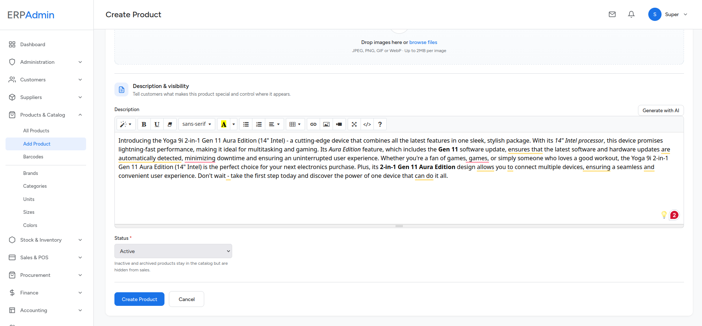
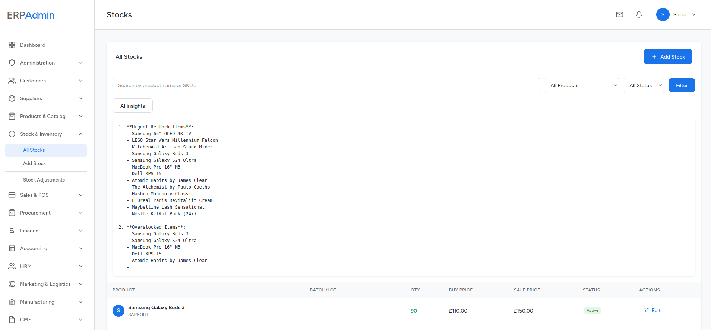
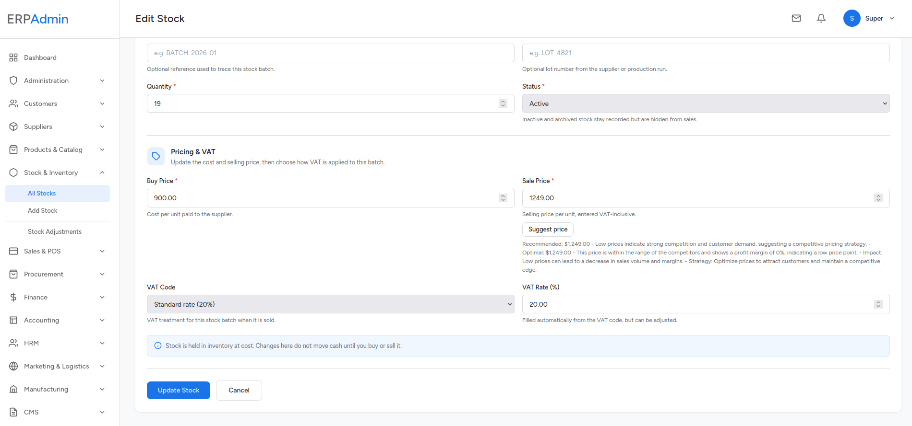
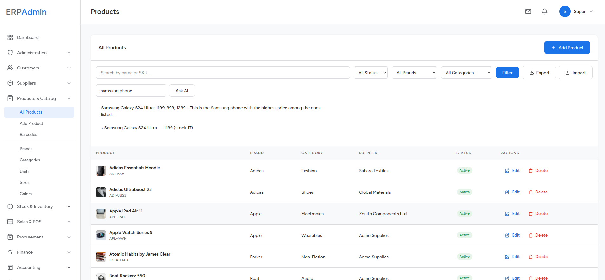
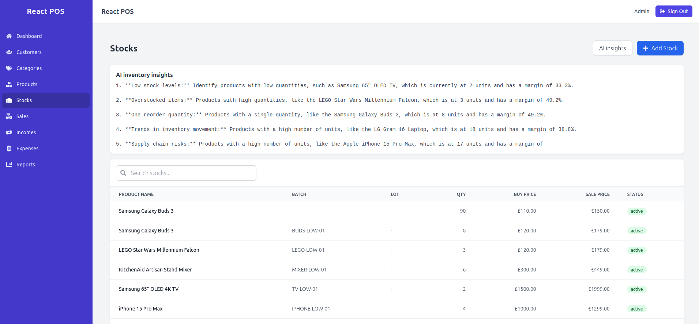
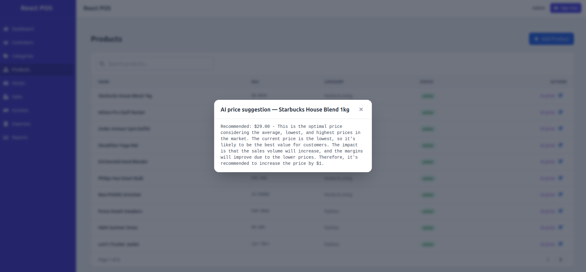
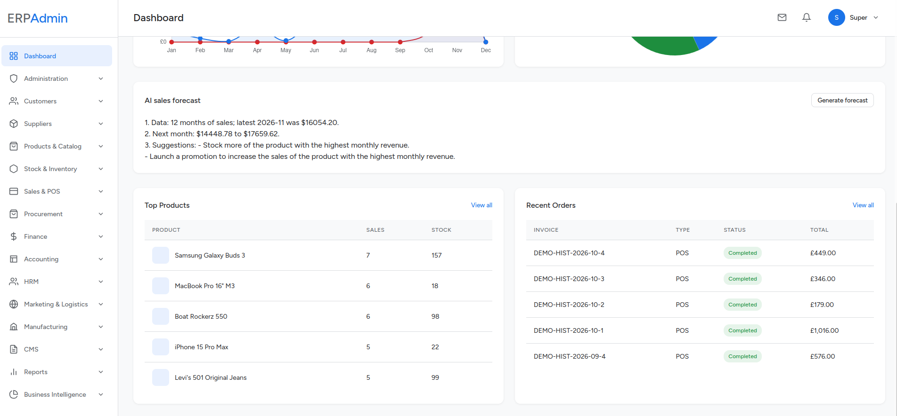

# Module 12 — AI & Business Intelligence

**Module:** AI & Business Intelligence (AI)
**Category:** Intelligence
**Purpose:** Adds an AI copilot layer over the ERP (support assistant, product search, description and price generation, inventory insights, sales forecasting) plus a Python/Flask BI layer and analytical reports.

> This module sits on top of all others. It consumes data already captured (sales, stock, catalog, customers) through a local Ollama model and a Flask BI service, and exposes AI-assisted actions to the storefront, the POS, and the admin panel.

## 1. Overview

The module provides:

- **AI support assistant** — customer-support chat grounded in matching product context.
- **AI product search** — natural-language querying of the catalog.
- **AI product description** — generated SEO copy from product attributes.
- **AI inventory insights** — analysis of active stock lines and margins.
- **AI sales forecast** — projection from the last 12 months of completed sales.
- **AI price suggestion** — recommendation using current price and recent sale-price statistics.
- **BI dashboards** — employee/product/combo/recommendation/prophet-forecast views backed by Flask.
- **Analytical reports** — sales, income, expense, stock, customer, supplier, and VAT-return reports.

## 2. AI Endpoints (API)

All endpoints are under `/api/v1/ai`:

| Endpoint | Method | Access | Purpose |
|---|---|---|---|
| `/ai/status` | GET | Public | Returns `{ available, model }`; checks Ollama and that the model is installed |
| `/ai/customer-support` | POST | Public | Support-assistant reply from `{ message }` |
| `/ai/product-description` | POST | Sanctum | Generate a description from `{ name, category?, specs? }` |
| `/ai/product-search` | POST | Sanctum | Natural-language search from `{ query }` |
| `/ai/inventory-insights` | POST | Sanctum | Insights over active stock lines |
| `/ai/sales-forecast` | POST | Sanctum | Forecast from the last 12 months of completed sales |
| `/ai/price-suggestion` | POST | Sanctum | Suggest a price from `{ product_id }` |

There are **no** `/ai/chat` or `/ai/forecast` endpoints.

### 2.1 Support Assistant (`/ai/customer-support`)

- Validates `message` (max 2000 chars).
- Extracts keywords (length ≥ 3) and attaches up to five matching products with SKU, price, and availability as context.
- Uses `OllamaService::customerSupport()` with a system prompt branded by `config('app.name')`.
- Returns `{ response }`; returns HTTP 500 with an error when Ollama fails.

### 2.2 Product Search (`/ai/product-search`)

- Sends the query plus the full lightweight product list (id, name, SKU, price, stock, category) to the model.
- Returns `{ response, products }`.
- Result ranking/reasoning is performed by the model, not a hard-coded scoring formula.

### 2.3 Description, Inventory & Pricing

- **Description:** generates copy from name, category, and specs.
- **Inventory insights:** summarises active stock lines with quantity, buy/sale price, and margin %.
- **Price suggestion:** loads the product's active stock price and recent (3-month) completed-sale average/min/max, then asks the model for a recommendation.

### 2.4 Sales Forecast (`/ai/sales-forecast`)

- Builds a 12-month monthly sales history for `completed` sales, filling missing months with zero.
- Sends the history to the model and returns `{ forecast }`.
- This is distinct from the BI Prophet forecast at `GET /bi/prophet-forecast`.

## 3. AI Configuration

| Setting | Default | Purpose |
|---|---|---|
| `OLLAMA_URL` | `http://erp_ollama:11434` | Ollama service URL (`config/services.php`) |
| `AI_MODEL` | `qwen2.5:0.5b` | Model name used for every AI request (tiny default for low-spec machines) |
| `ACCOUNTING_*` | — | Not AI-related; see Finance module |

`OllamaService` uses `POST /api/chat` with a 120-second timeout and `GET /api/tags` for availability/model checks. If Ollama is down or the configured model is not pulled, endpoints return `null` and the controllers respond with a 500 error; the UI must degrade gracefully.

## 4. BI Layer (Flask)

`BiController` proxies to the Flask service configured by `BI_API_URL` (default `http://bi_flask:5000/api`; the BI repository recommends `http://bi_nginx:80/api/v1`) with a 30-second timeout and an `X-API-Key` header. Admin routes (inside the `auth:admin` group, no extra permission middleware):

| Route | Flask endpoint (`/api/v1`) | Purpose |
|---|---|---|
| `GET /bi` | `POST /analyze`, `GET /product-analysis`, `GET /sales-forecast`, `GET /product-combos` | BI dashboard |
| `GET /bi/employees` | `POST /analyze` | Employee analysis |
| `GET /bi/products` | `GET /product-analysis` | Product analysis |
| `GET /bi/recommendations` | `POST /recommendations/products` | Product recommendations (`strategy`, limit 20) |
| `GET /bi/forecast` | `GET /sales-forecast` | Sales forecast |
| `GET /bi/prophet-forecast` | `GET /prophet-forecast?periods=N` | Prophet forecast (default 12 periods) |
| `GET /bi/combos` | `GET /product-combos` | Frequently bought-together combos |

Forecast payloads are cached (`FORECAST_CACHE_TTL`, default 6 h); the BI service exposes `POST /internal/refresh` for scheduled recomputation and `GET /internal/cache-status` to report cache age. The Flask BI app lives in the separate [shaik-obydullah/bi-system](https://github.com/shaik-obydullah/bi-system) repository (`flask-app/`); the Laravel side is only a thin, error-tolerant proxy (`{status: error, message}` on failure).

## 5. Analytical Reports

`ReportController` renders:

| Route | Purpose |
|---|---|
| `GET /reports` | Overview: sales, income, expenses, net profit, counts, 12-month chart |
| `GET /reports/sales` | Sales report |
| `GET /reports/income` | Income report |
| `GET /reports/expense` | Expense report |
| `GET /reports/stock` | Stock/inventory valuation |
| `GET /reports/customers` | Customer report |
| `GET /reports/suppliers` | Supplier report |
| `GET /reports/vat-return` | UK-style 9-box VAT return (quarter by default), reconciled to the ledger |

**All report routes use `permission:dashboard.view`** (not `reports.view`). The `Reports` permission group exists but is not currently attached to these routes.

### 5.1 VAT Return

`VatReturnController` joins sales/incomes/returns/expenses/purchase orders to `transactions` / `journal_entries`, computes output and input VAT for the selected period, and supports filtering by a specific box.

## 6. Dashboard & Charting

- Dashboard KPIs and Chart.js visuals consume aggregated arrays (`monthlySales`, `monthlyExpenses`, top categories, recent sales) from `DashboardController`.
- AI forecast output is a text response; it is not automatically merged into the dashboard chart arrays.
- BI views have their own `resources/views/bi/` pages.

## 7. Integration Points

| Consumer | Feature |
|---|---|
| Admin panel | Dashboard/report charts, BI pages, AI helpers |
| React POS | Product search, description, price suggestion, inventory insights, sales forecast (Sanctum) |
| Storefront | AI customer-support widget and AI status check (public) |

## 8. Permissions

| Area | Access |
|---|---|
| AI public endpoints | `/ai/status`, `/ai/customer-support` |
| AI protected endpoints | `auth:sanctum` |
| BI routes | `auth:admin` + `active.admin` (no per-route permission) |
| Reports | `permission:dashboard.view` |
| Reports permission group | `reports.view/save/edit/delete` (seeded but not used by routes) |

## 9. Related Code Locations

- AI controller: `laravel/app/Http/Controllers/Api/AiController.php`
- AI service: `laravel/app/Services/OllamaService.php`
- BI controller: `laravel/app/Http/Controllers/BiController.php`
- BI Flask app: [shaik-obydullah/bi-system](https://github.com/shaik-obydullah/bi-system) (`flask-app/`)
- Reports: `laravel/app/Http/Controllers/{ReportController,VatReturnController}.php` and `laravel/resources/views/reports/`
- Config: `laravel/config/services.php` (`ollama.url`, `ollama.model`), `AI_MODEL` env

## 10. Screenshots

The screenshots below show the AI copilot features in the admin panel and the React POS. All generative features run on the local `qwen2.5:0.5b` model.

**AI product description (Create Product)**

**AI inventory insights (Stocks)**

**AI price suggestion (Stock Pricing)**

**AI product search**

**React POS — AI inventory insights**

**React POS — AI price suggestion**

**AI sales forecast**

